<p align="center">
  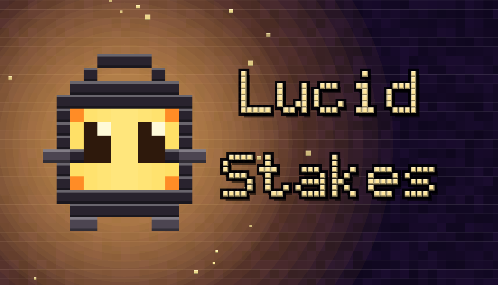
</p>

<h1 align="center">Lucid Stakes</h1>

<p align="center"><b>Un puzzle de torres de cubos con casino y economía de boosts.</b><br>
Hecho en Godot 4 (GDScript) con un solucionador exacto en C++ y herramientas en Python.</p>

> **In short (EN):** *Lucid Stakes* is a single-player 3D voxel puzzle game. Each stage you climb a procedurally assembled tower of block-pushing puzzles (every room is verified by an exact A* solver written in C++), then spend what you earned in a casino (roulette, slots, blackjack, dice, shop, contracts) on boosts that change how you play, and pay a toll to move on. Solo project built in Godot 4.7 / GDScript, with a C++ GDExtension, a Python room-generation pipeline, a custom voxel font and renderer, an economy calibrated with a bot, full ES/EN localization, gamepad support and a colour-blind mode. ~51k lines of GDScript, 74 automated tests, a Windows build and a Steam-oriented demo.

---

## El concepto

El jugador está atrapado en una pesadilla hecha de recuerdos corruptos. Lo único que le queda es **claridad**: lo que todavía no se corrompió. Para escapar tiene que subir quince torres, y entre una y otra pasa por un casino y le paga un peaje, en claridad, a **Farolín**, un farol que cuida la salida.

**El bucle de cada etapa:**

1. **Torre.** Un puzzle de bloques en 3D: caminar, empujar, tirar, colgarse de cornisas y soltarse para abrir un camino hasta el portal. Cada sala tiene un tope de movimientos calculado por un solucionador exacto. Perder una sala cuesta una vida.
2. **Casino.** Lo que se junta en la torre se juega y se invierte: ruleta de premios, tragamonedas, blackjack, dados, tienda, contratos y taller. Los premios son **boosts** y **consumibles** que cambian las reglas de la torre o la economía.
3. **Peaje.** Farolín cobra para pasar a la siguiente torre. El precio sube con la etapa y con la dificultad, así que hay que llegar con un buen *build*.

La idea de diseño es que **el puzzle sea el centro** y la suerte solo decida cuánto se invierte, no si se avanza. Cada tres etapas hay una **prueba** que cambia una regla (sin consumibles, sin reintentos, una gata que mueve bloques, cámara que se marea, terremotos, bloques en la oscuridad…), con un jefe final que combina dos.

<p align="center">
  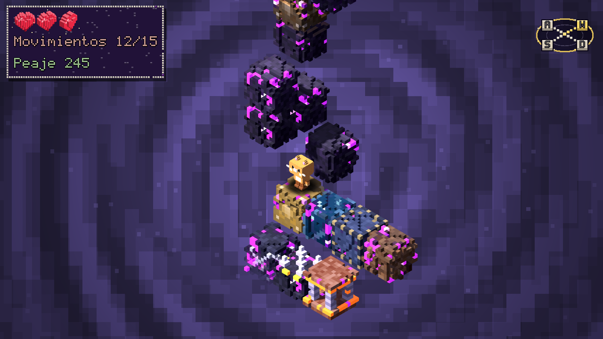<br>
  <sub>Una sala de la torre: bloques especiales, el peaje y los movimientos arriba a la izquierda.</sub>
</p>

---

## Capturas

### Entrar al juego y aprender a jugar

| Menú principal | Taberna (el tutorial empieza caminando) |
|---|---|
| 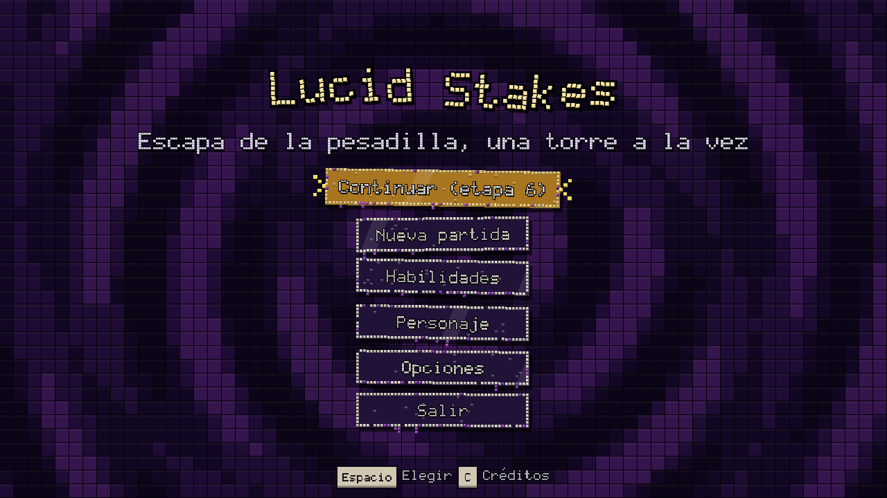 | 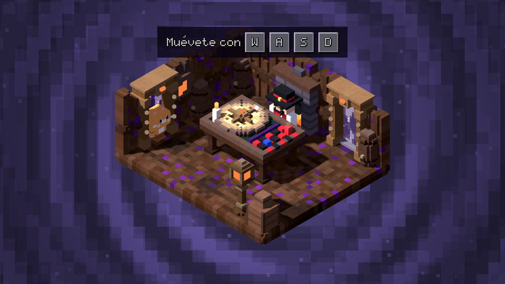 |

| Lección: empujar | Lección: soltarse de una cornisa |
|---|---|
| 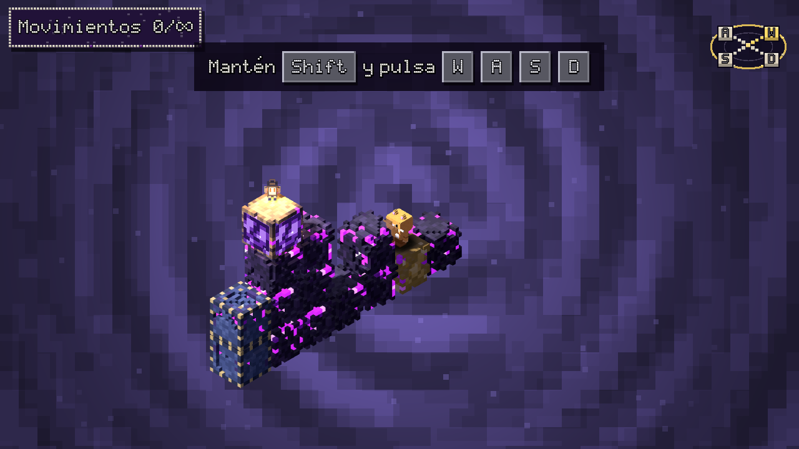 | 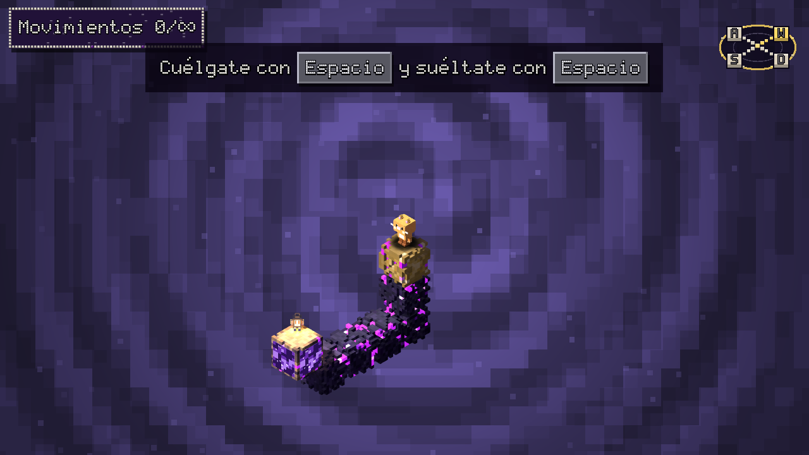 |

El tutorial se rehízo pensando en el orden de aprendizaje: se aprende a caminar en la taberna (con las teclas a la vista), después la cámara, empujar, tirar, colgarse y soltarse, y cierra con una torre real. Nada se repite por no haber apretado una tecla y el tabernero habla lo mínimo.

### Tomar decisiones

| Dificultad (4 niveles) | Escenarios que cambian las reglas |
|---|---|
| 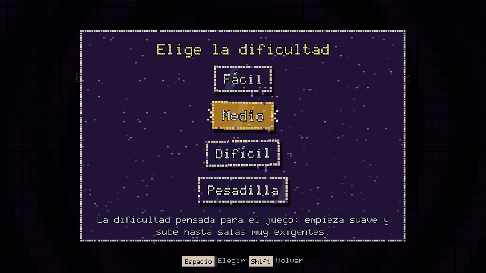 | 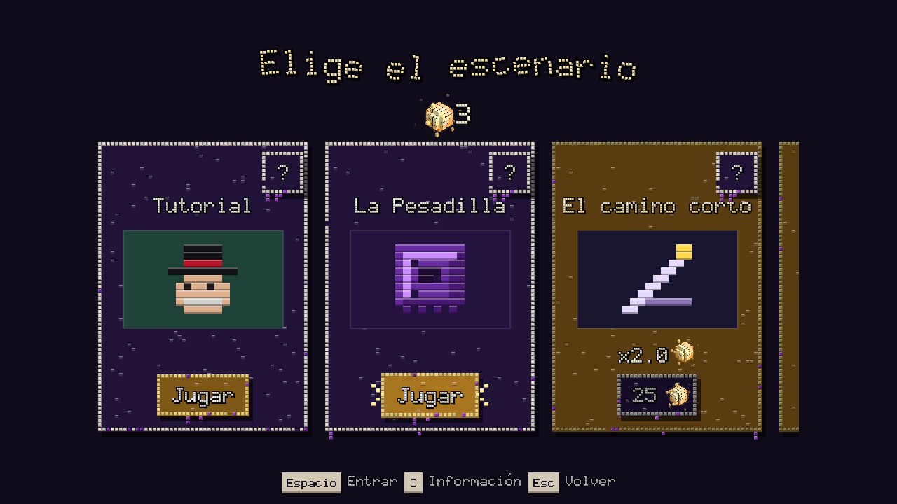 |

| Panel de información (boosts, consumibles, contratos) | Diálogo del tabernero |
|---|---|
| 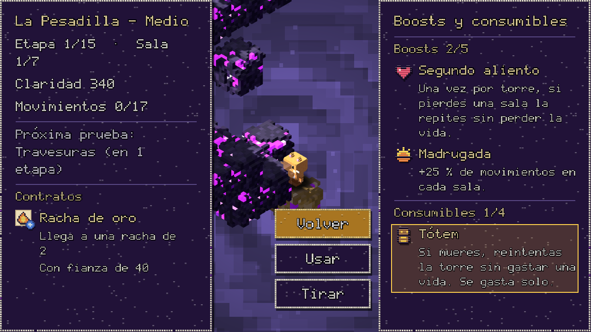 | 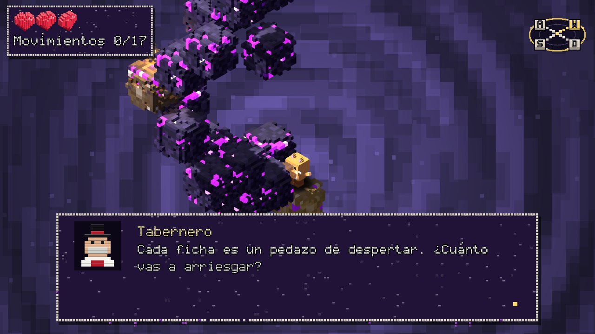 |

### El casino, hecho entero de cubitos

| Casino de nivel 1 | Gran casino |
|---|---|
| 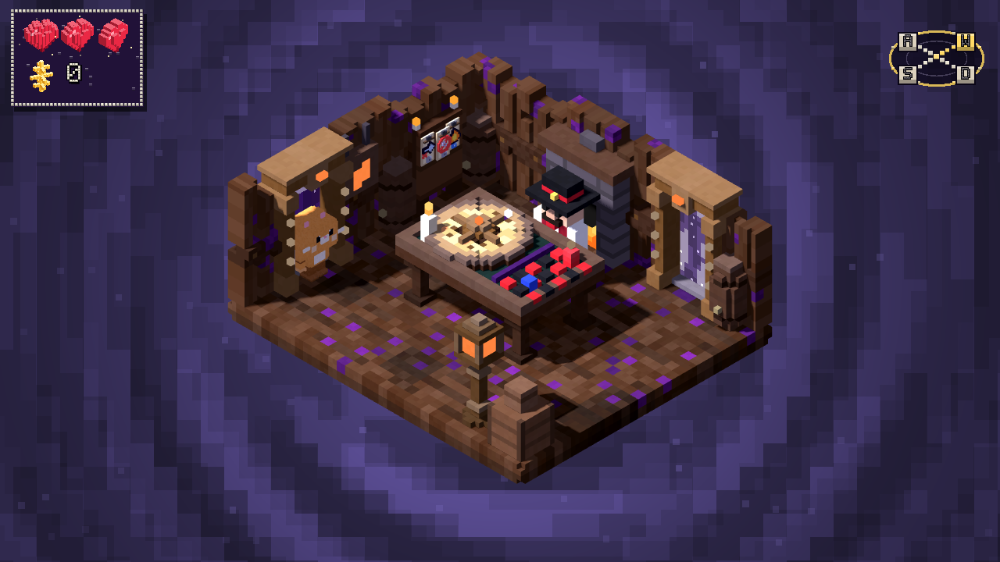 | 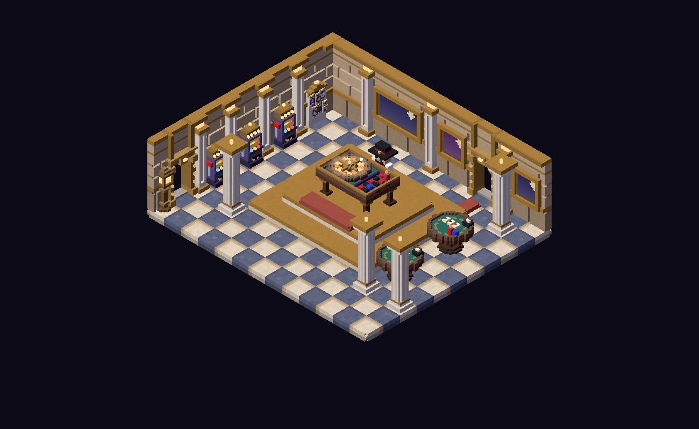 |

| Ruleta de premios | Tragamonedas con retener |
|---|---|
| 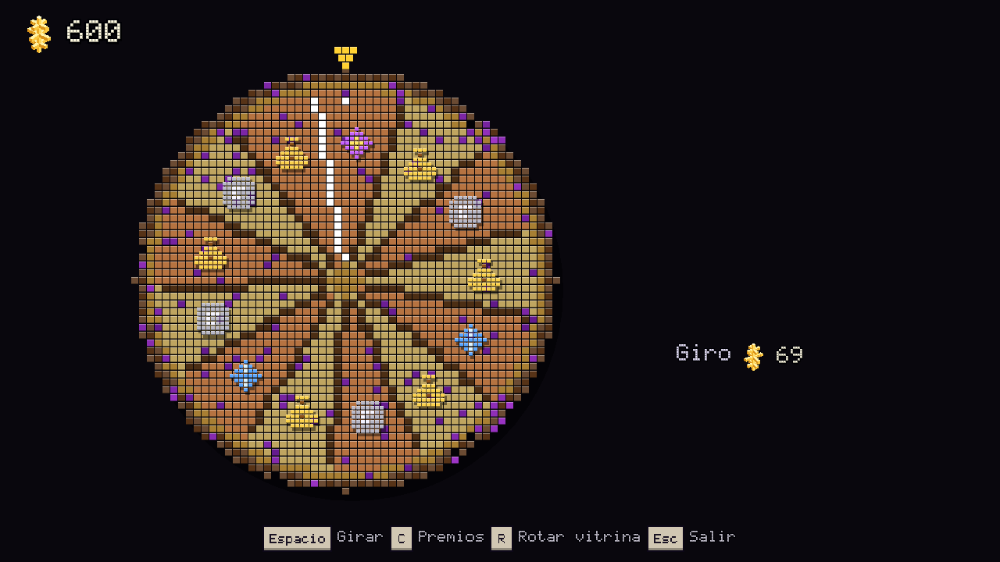 | 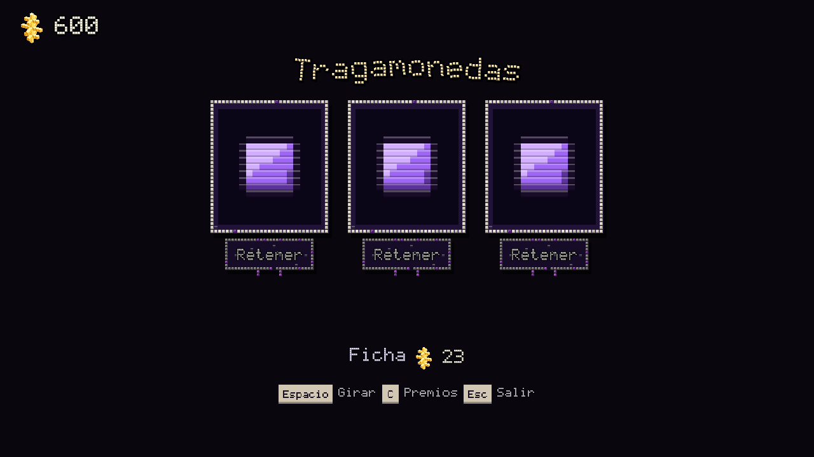 |

| Dados del tabernero | Galería de bloques |
|---|---|
| 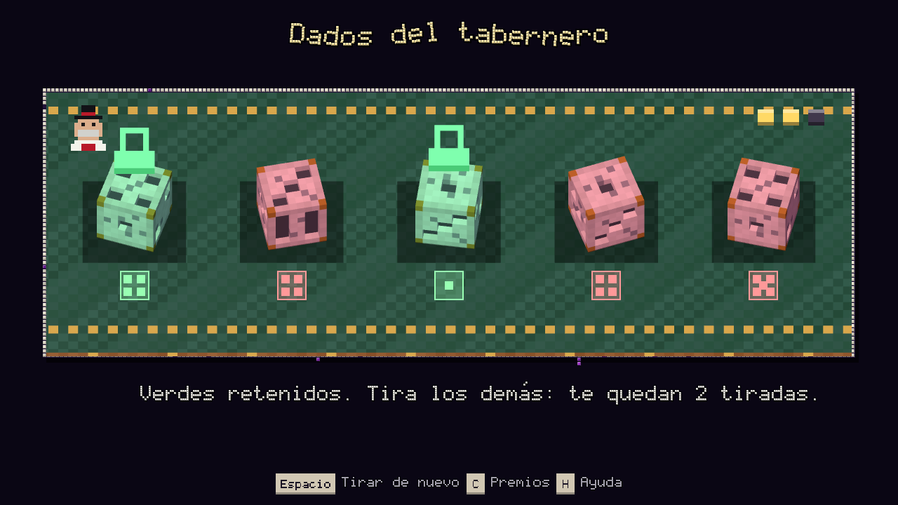 | 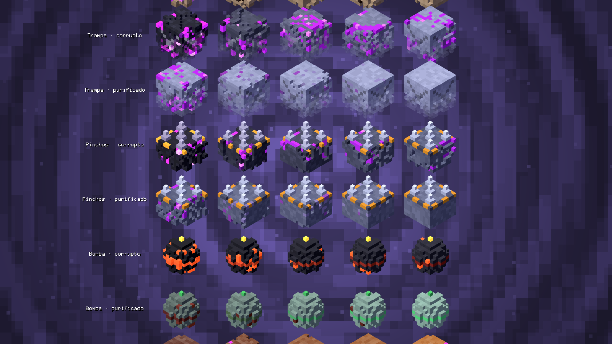 |

Cuatro casinos (taberna, salón, casino y gran casino) diseñados enteros, con los muebles modelados en minibloques de 0,1; los dados y su mesa también progresan con el nivel.

### Herramientas internas y accesibilidad

| Estudio de salas (editor y verificador) | Modo daltonismo (apagado / prendido) |
|---|---|
| 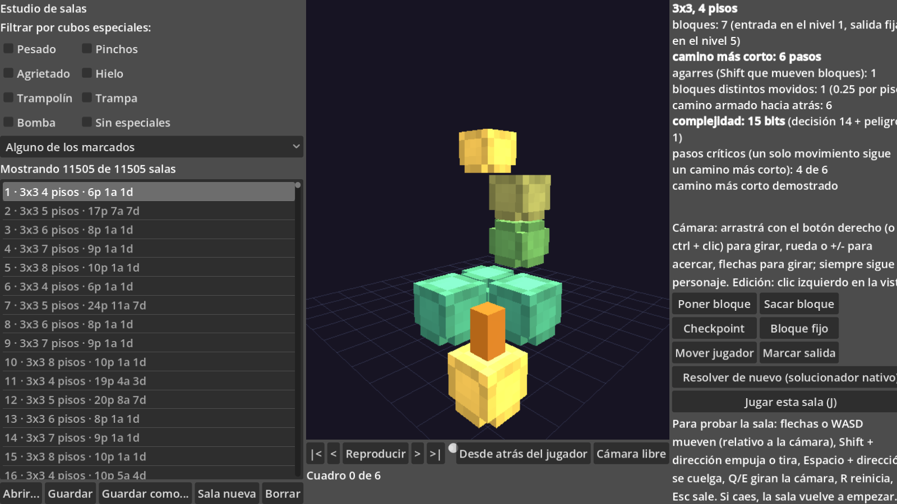 | 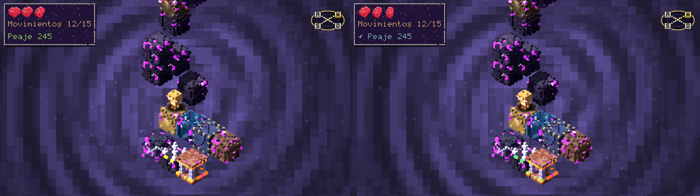 |

---

## Lo que lo hace interesante como ingeniería

- **Solucionador exacto en C++, integrado como GDExtension.** Un A\* sobre el estado completo de la sala (jugador, bloques, agarres, caídas) calcula el mínimo de movimientos de cada sala. Ese mínimo es la base del temporizador, de la dificultad y de la verificación de que toda sala es resoluble. Se usa en vivo dentro del juego y también como ejecutable de línea de comandos para el generador. Hay además una versión de referencia en GDScript con la que se contrasta.
- **Biblioteca de 11.505 salas generadas y verificadas.** Un generador (C++ y Python) propone salas, el solucionador las resuelve, se miden métricas (bloques distintos movidos, bits de decisión, pasos críticos) y se descartan las degeneradas. Un filtro en tiempo de armado elige las salas según la dificultad. Las torres son **deterministas por semilla**.
- **Un sistema gráfico y una tipografía propios.** Todo, desde los personajes y los bloques hasta la interfaz, se dibuja con cubitos. Hay una fuente de 5×7 celdas con acentos y colas, un renderer de etiquetas con contorno y sombra, y un generador que **exporta esa fuente como `.ttf`/`.woff2`** (tres pesos y cursiva) para usarla en la web.
- **Economía calibrada con un bot.** Un bot juega runs completos por el camino mínimo para medir qué porcentaje de partidas se gana según el peaje y la dificultad. Con eso se ajustaron la curva del peaje, el precio de las fichas y la tienda. Como el bot es casi perfecto, el balance fino se hace con **telemetría local** de jugadores reales (nada se envía).
- **Datos que no se pierden.** Guardado, perfil y opciones se escriben a un archivo temporal y se renombran, con copia anterior; se guarda a mitad de sala; el perfil descarta valores de otro tipo.
- **Accesibilidad y alcance.** Modo daltonismo (un filtro de pantalla que lleva los verdes al azul más símbolos y paleta alternativa), control completo con mando (Xbox y PlayStation, con la ayuda de botones dibujada con la misma fuente), interfaz en **español e inglés**, tamaño de interfaz y ajustes gráficos que se eligen solos la primera vez según la tarjeta de video.
- **Una demo recortada con el mismo código.** Un interruptor (`Demo.on()`) limita el juego hasta el segundo casino, guarda aparte y esconde lo que no existe en la demo, pensada para una página de Steam.

---

## Herramientas y tecnologías

| Área | Qué se usó |
|---|---|
| Motor y lenguaje | **Godot 4.7.2**, **GDScript**, renderer GL Compatibility |
| Código nativo | **C++** (A\*, generador, métricas), **GDExtension** con godot-cpp y SCons, g++ de MSYS2 |
| Herramientas | **Python** (generador y fusión de bibliotecas, variantes, catálogo en Excel, generación de la fuente con fontTools), scripts `.bat` y `.ps1` |
| Datos | JSONL (salas, modelos de personajes y ropa), JSON para guardado, perfil y opciones |
| Calidad | **74 pruebas automáticas** que corren sin pantalla, sondas de balance con el bot, 66 scripts de captura, revisión de todos los scripts por compilación |
| Arte y sonido | Modelado propio con un **editor de modelos de cubitos** hecho para el proyecto, bloques de 10×10×10, música y efectos |
| Control de versiones | Git y GitHub: una rama por cambio, commits en cada hito, merge a `main` al cerrar |
| Desarrollo asistido | **Claude Code** (asistente de IA de Anthropic) para programar en pareja, revisar y escribir pruebas, bajo diseño y decisiones del autor |

---

## Proceso de desarrollo

El proyecto avanzó en iteraciones cortas, siempre con la misma disciplina:

1. **Diseño primero.** Los sistemas grandes se conversaron y se escribieron antes de programarlos (`docs/diseno.md`, `docs/reglas_torre.md`, `docs/economia.md`, `docs/plan_casinos.md`). Las reglas exactas de la torre están documentadas para que puzzle, solucionador y generador coincidan.
2. **Probar lo que se construye.** Cada sistema tiene sus pruebas; el conjunto completo corre en una hora y termina en `fallos: 0`. Las decisiones de dificultad se juzgan **jugando y mirando capturas**, no solo con métricas: la que importa es la de bloques distintos movidos, no la de movimientos.
3. **Descartar lo que no funciona.** La torre pasó por varias versiones (núcleo sólido, piso que cae, torre cilíndrica, escenario de hielo) y se retiraron las que no daban buenos puzzles; lo aprendido quedó en `docs/aprendizajes.md` y el código viejo se borró del repositorio.
4. **Limpieza deliberada.** Una limpieza en seis fases reordenó el repositorio en carpetas por tema, borró lo muerto y dejó reglas para no volver a ensuciarlo.
5. **Ronda de testers.** Un grupo de testers jugó una versión y devolvió más de treinta puntos (economía inalcanzable, tutorial confuso, falta de daltonismo, jerga, riesgo de perder partidas…). Cada uno se priorizó, se resolvió o se descartó con motivo, y quedó registrado.
6. **Pulido antes de entregar.** Guardado atómico, ajustes gráficos automáticos, tutorial reescrito, texto más legible, daltonismo completo, y una pasada de pruebas sobre la versión final.

En números: unas **51.000 líneas de GDScript** en 310 archivos, 2.000 de C++, más de mil de Python, 9 shaders, 22 documentos de diseño y más de 650 commits en menos de un mes de trabajo.

---

## Estructura del repositorio

```
scripts/        el juego (main.gd, ui/, casino/, datos/, personajes/, idioma/, entrada/, sonido/, herramientas/)
torre/          el motor del puzzle, el armado de torres, el solucionador de referencia y el dibujo 3D
native/         solucionador, generador y métricas en C++ (+ la GDExtension)
data/           biblioteca de 11.505 salas, variantes de la gata y modelos
shaders/        fondo, portal, bloques de cristal y hielo, silueta y filtro de daltonismo
herramientas/   scripts de uso diario (jugar, demo, catálogo, generar y fusionar salas, construir)
tests/          unitarios/ (74), sondas/ (balance, auditorías) y capturas/ (66 scripts)
docs/           diseño, reglas, economía, generador, catálogo de contenido, plan de casinos…
web_fuente/     la fuente de cubitos como fuente web
```

Para entender el juego a fondo conviene empezar por [`docs/diseno.md`](docs/diseno.md), [`docs/reglas_torre.md`](docs/reglas_torre.md), [`docs/generador.md`](docs/generador.md) y [`docs/economia.md`](docs/economia.md).

---

## Cómo correrlo

Requisitos: **Godot 4.7.2** (el ejecutable no se versiona) y, para armar el solucionador nativo, g++ de MSYS2 y SCons.

```bash
# 1. Armar el solucionador nativo (extensión de Godot)
native\construir_extension.bat

# 2. Abrir el proyecto y jugar
godot --path .

# 3. Todas las pruebas (tardan más de una hora; terminan en "fallos: 0")
bash tests/correr_todos.sh

# 4. Exportar el juego y la demo para Windows (hacen falta las plantillas de exportación)
powershell -ExecutionPolicy Bypass -File herramientas\construir.ps1
```

Las pruebas y las capturas usan `GAME_SANDBOX=1` para no tocar las partidas reales.

---

## Estado y límites

- Funciona de punta a punta: 15 etapas, 4 dificultades, 15 pruebas, 8 escenarios (más el tutorial), el casino completo, 37 boosts, 21 consumibles, 5 personajes y 13 cosméticos.
- Hoy se exporta **solo para Windows**.
- El balance fino necesita más partidas de jugadores reales; el juego ya registra la telemetría para calibrarlo.
- Falta publicar la página de Steam (AppID, logros, política de privacidad, tráiler) y firmar el ejecutable.

---

<p align="center"><sub>Proyecto personal de <b>Dante Sinesi</b>.</sub></p>
