

  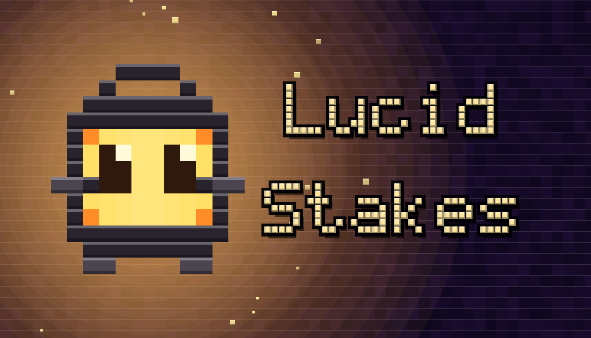

# Lucid Stakes

Un juego de puzzle de torres de cubos con un casino en el medio. Subes una torre moviendo bloques, gastas lo que juntas en el casino y pagas para pasar a la siguiente.

*In short: a single-player voxel puzzle game where you climb block-pushing towers, spend your earnings in a casino on boosts, and pay a toll to move on. Godot 4, GDScript, C++.*

## Qué te da

- **Puzzles de bloques en 3D.** Caminas, empujas, tiras y te cuelgas de los bordes para abrir camino hasta el portal.
- **Torres que cambian en cada partida.** Cada torre se arma al momento con salas que ya se comprobaron como resolubles.
- **Un casino que da decisiones.** Ruleta, tragamonedas, blackjack y dados te dan mejoras que cambian cómo juegas.
- **Errores que no son el fin.** Perder una sala cuesta una vida y vuelves al último punto seguro.

## Cómo funciona

El juego repite tres pasos en quince etapas. Primero la torre, después el casino y al final el peaje de Farolín, un farol que cuida la salida y cobra en claridad, la moneda del juego.

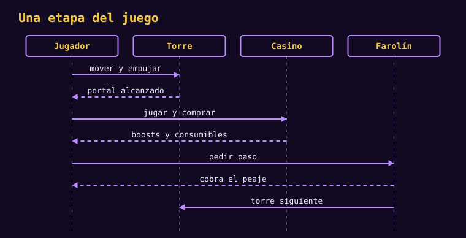 En cada etapa se sube la torre, se juega el casino y se paga el peaje para seguir.

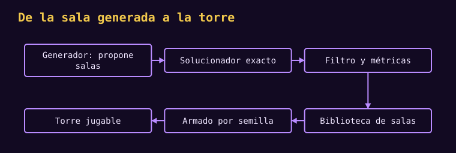 Cada sala se genera, se resuelve y se filtra antes de llegar a una torre jugable.

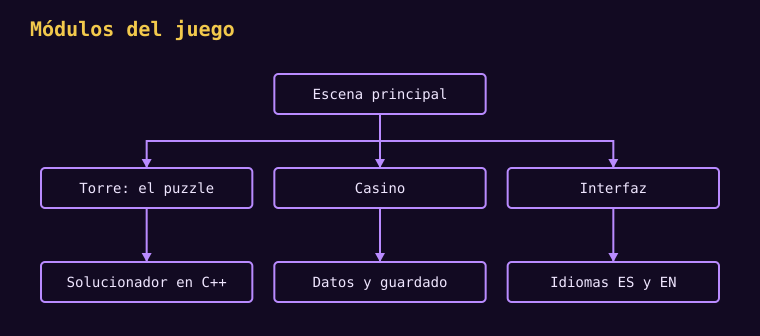 La escena principal conecta la torre, el casino y la interfaz; el puzzle usa el solucionador en C++.

## Cómo se ve

| Tutorial: empujar un bloque | Una sala de la torre |
|---|---|
| 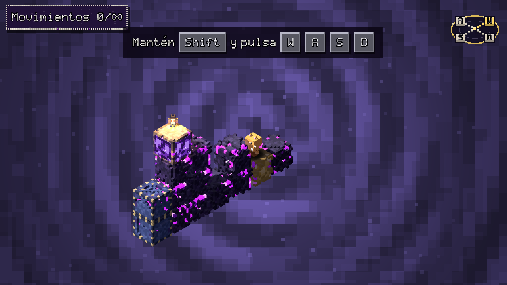 | 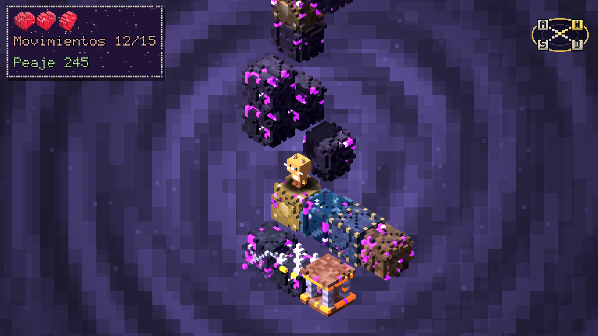 |

| Casino de los primeros niveles | Gran casino |
|---|---|
| 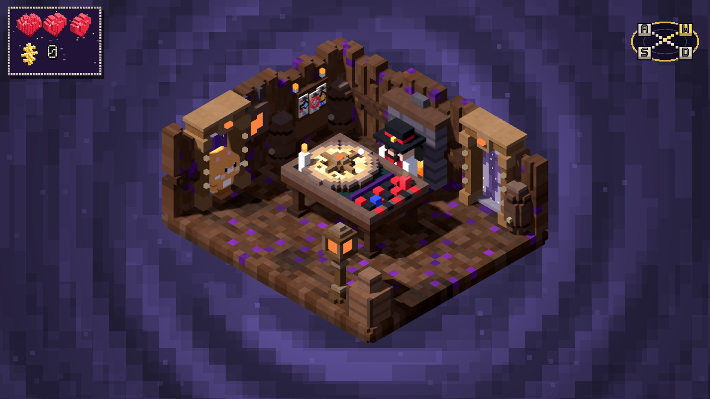 | 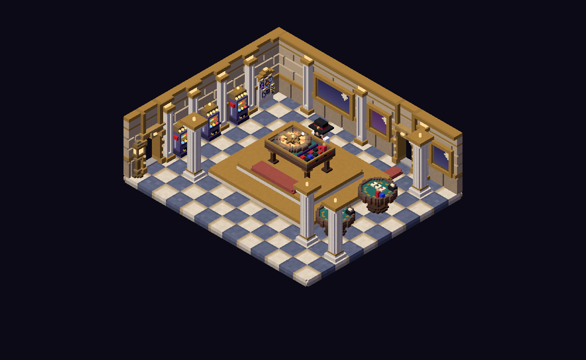 |

| Ruleta de premios | Dados del tabernero |
|---|---|
| 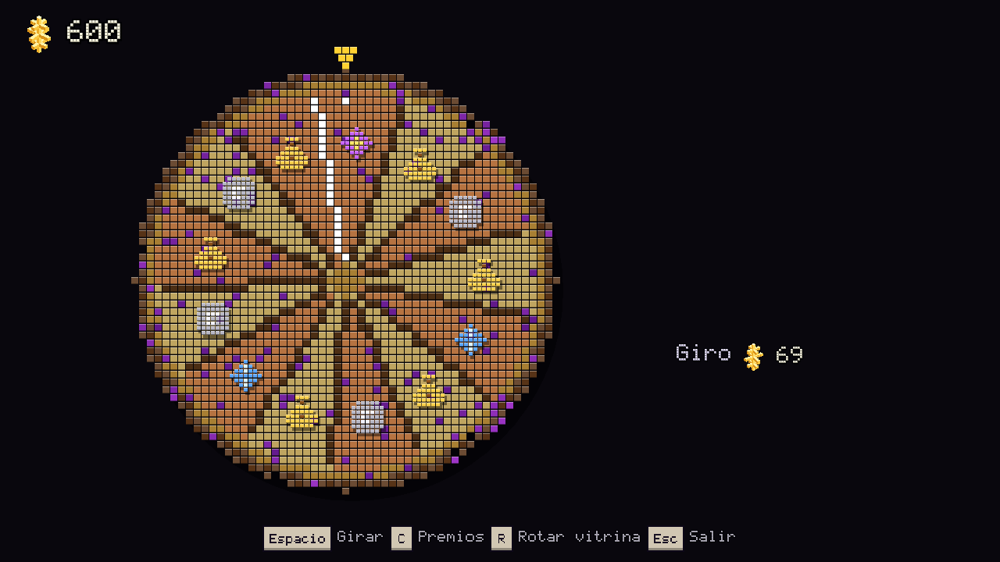 | 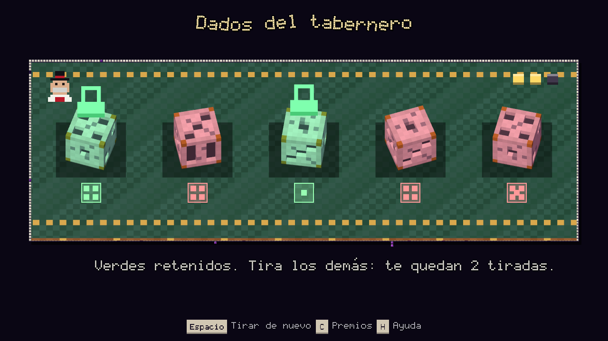 |

| Escenarios que cambian las reglas | Panel con boosts y consumibles |
|---|---|
| 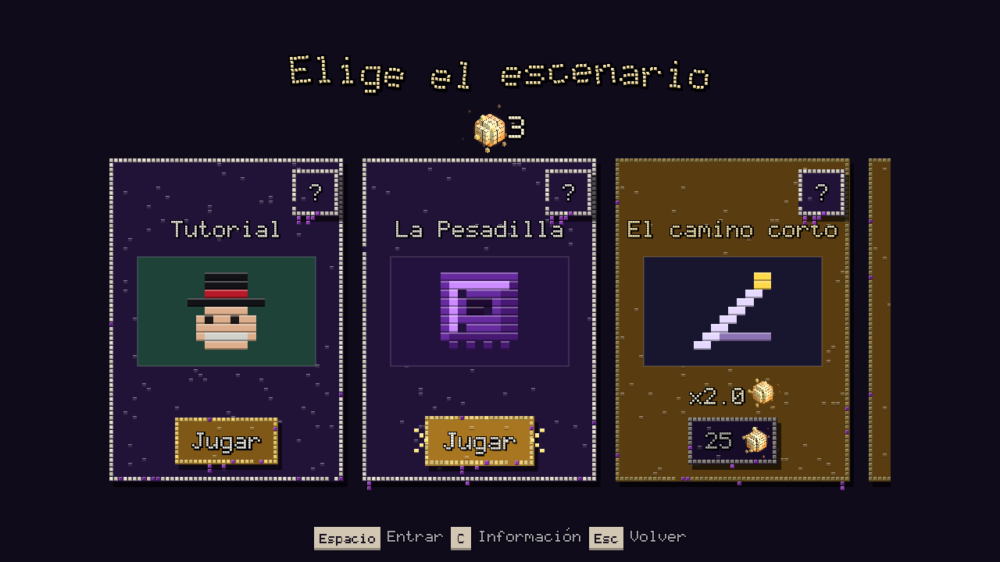 | 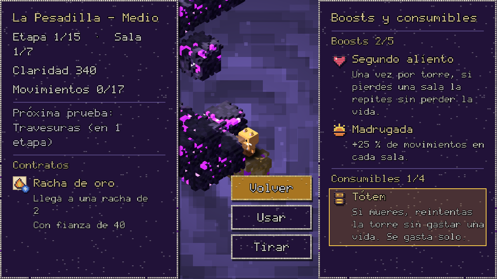 |

| Estudio de salas (herramienta interna) | Modo daltonismo, apagado y encendido |
|---|---|
| 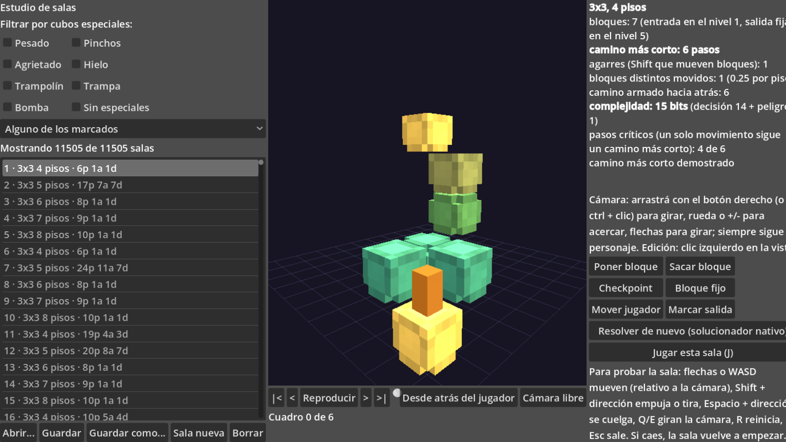 | 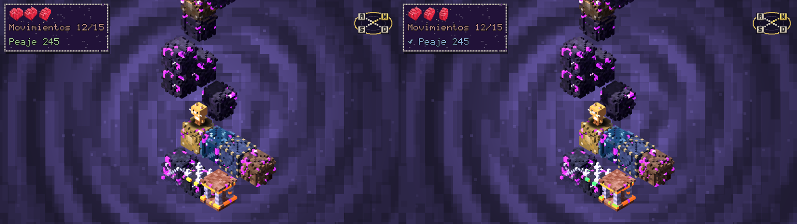 |

## Cómo empezar

1. Instala **Godot 4.7.2** y ármale el solucionador: `native\construir_extension.bat` (necesita g++ de MSYS2 y SCons).
2. Abre la carpeta en Godot, o corre `godot --path .`.
3. La primera vez, el juego empieza solo con el tutorial.

## Más información

- [`docs/diseno.md`](docs/diseno.md): cómo es el juego hoy.
- [`docs/reglas_torre.md`](docs/reglas_torre.md): las reglas exactas del puzzle.
- [`docs/generador.md`](docs/generador.md): cómo se generan y se comprueban las salas.
- [`docs/economia.md`](docs/economia.md): peaje, fichas y calibración.
- [`docs/proceso.md`](docs/proceso.md): cómo se construyó el juego y qué se decidió en el camino.
- [`docs/catalogo.md`](docs/catalogo.md): todo el contenido (premios, bloques, escenarios, pruebas).

## Para quien colabora

**Requisitos.** Godot 4.7.2 (el ejecutable va en `tools/` y no se versiona), Python 3 para las herramientas y g++ con SCons para el código nativo.

**Estructura.**

| Carpeta | Qué contiene |
|---|---|
| `scripts/` | El juego: la escena principal, la interfaz, el casino, los datos, los personajes, los idiomas y el sonido |
| `torre/` | El motor del puzzle, el armado de torres, el solucionador de referencia y el dibujo |
| `native/` y `extension/` | El solucionador en C++ y su extensión de Godot |
| `data/` | La biblioteca de salas (11.505) y los modelos de personajes y ropa |
| `shaders/` | Fondo, portal, bloques de cristal y hielo, silueta y filtro de daltonismo |
| `scenes/` | La escena principal y la galería de bloques |
| `audio/` | La música |
| `icono/` | El ícono del juego |
| `herramientas/` | Scripts de uso diario: jugar, generar salas, catálogo, construir |
| `tools/` | Los ejecutables locales (Godot y el solucionador); no se versionan |
| `tests/` | Las pruebas, las sondas de balance y los scripts de captura |
| `docs/` | El diseño, las reglas y los diagramas |
| `web_fuente/` | La fuente de cubitos como fuente web |
| `bibliotecas/`, `capturas/` y `build/` | Lo que se genera (salas, imágenes y exportaciones); no se versiona |
| `arte conceptual/` | Bocetos del autor; no se versionan |

**Pruebas.** Cada prueba corre sin pantalla y termina con `fallos: 0` si está bien. Todas juntas: `bash tests/correr_todos.sh` (tardan más de una hora). Una sola: `GAME_SANDBOX=1 godot --headless --path . -s tests/unitarios/test_menus.gd`. La variable `GAME_SANDBOX=1` evita tocar las partidas reales.

**Exportar.** `powershell -ExecutionPolicy Bypass -File herramientas\construir.ps1` arma el juego y la demo para Windows.

**Decisiones técnicas.**

- El solucionador exacto define el tope de movimientos de cada sala y comprueba que sea resoluble.
- Las torres dependen de una semilla: la misma semilla da la misma torre.
- La economía se calibra con un bot que juega partidas completas; el ajuste fino usa la telemetría local, que nunca se envía.
- Guardado, perfil y opciones se escriben primero a un archivo temporal, así un corte de luz no los deja a medias.
- Toda frase del juego está en español neutro y en inglés.

**Cómo se trabaja.** Una rama por cambio, commits en español y merge a `main` al terminar. El diseño se escribe antes de programar los sistemas grandes (están en `docs/`).

---

Proyecto personal de **Dante Sinesi**.
